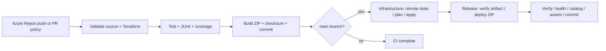

# Full VoltElectronics Azure DevOps pipeline



The complete executable definition is `azure-pipelines.yml`. `deployAzure` defaults to false so CI runs immediately without an Azure service connection. When the backend and service connection are ready, select Deploy to Azure when queueing main to include Infrastructure, Release and Verify. The Terraform installer is a reusable template under `pipelines/templates/`. No marketplace Terraform extension is required.

| Stage | What runs | Evidence in Azure DevOps |
| --- | --- | --- |
| Validate | Python compile, JavaScript syntax, Terraform format/init/validate for app and backend bootstrap | Job logs |
| Test | Ecommerce regression tests with pytest and coverage | Tests tab, JUnit report, Coverage tab |
| Build | Deterministic source ZIP, commit/build metadata, SHA256 | `application` artifact |
| Infrastructure | Federated login, Entra-authenticated remote state, saved plan and exact-plan apply | Terraform plan/apply logs and environment deployment |
| Release | Download artifact from this run, verify checksum, deploy ZIP | App Service deployment logs |
| Verify | Read-only checks for database health, catalog, HTML, JS/CSS and deployed Git commit | Smoke-test log |

## First-run prerequisites

1. Sign in to Azure CLI as `giftzee.online@gmail.com`. Verify the subscription and tenant. Obtain the exact VoltElectronics Azure DevOps organization URL.
2. Initialize remote state using `scripts/bootstrap.ps1`. The state account/container must exist before the main pipeline runs. Bootstrap is a separate one-time operation and its state is migrated to `volt-electronics/bootstrap.tfstate`.
3. Create/push the repository's `main` branch and create the Azure Resource Manager federated service connection. It needs app-resource management access and Blob Data Contributor on the state account.
4. Run `scripts/setup-devops.ps1` with the actual organization URL, subscription, service connection, globally unique web app name, and backend storage name. It creates/reuses the project/repo/pipeline, sets variables and adds blocking main-branch PR build validation. It does not push or commit local files.
5. Create the `volt-electronics-production` environment. Add an **exclusive lock** check and authorize this pipeline's service connection. Add environment approval if desired. `lockBehavior: sequential` only has effect when the environment lock check exists.
6. Queue `main`. Review all six stages and open the app URL from the infrastructure stage logs.

```powershell
.\scripts\setup-devops.ps1 `
  -Organization https://dev.azure.com/edukrondevops `
  -Project VoltElectronics `
  -ServiceConnection volt-electronics-azure-wif `
  -SubscriptionId YOUR_SUBSCRIPTION_ID `
  -AppName YOUR_GLOBALLY_UNIQUE_APP_NAME `
  -StateStorageAccount YOUR_BACKEND_STORAGE_NAME
```

Azure Repos PR validation is a branch policy, not a YAML `pr` trigger. Reference: [Microsoft branch build-validation policies](https://learn.microsoft.com/en-us/azure/devops/repos/git/branch-policies#build-validation).

## Deployment behavior

Feature/codex branches and PR validation run Validate, Test and Build. Infrastructure, Release and Verify explicitly require `refs/heads/main` and reject PullRequest runs. Environment checks are managed in Azure DevOps, outside YAML.

Terraform plans stay on the deployment agent and are not published because plans can contain the session secret. Provider lock files support Linux build agents and Windows development. Backend state uses Entra identity and blob locking. The deployment is one instance and one Python worker to match SQLite's constraints.

Pipeline stage locks protect each environment stage, not an entire multistage run. Batch CI reduces overlapping main runs. Avoid manually queueing concurrent main deployments; infrastructure and application releases can otherwise interleave between stage locks. Smoke verification fails if another release replaces the expected commit.

## Failure and recovery

- Validate/Test failure: deployment stages never run.
- Terraform failure: application release never runs; inspect the remote state/plan output and retry after correcting the cause. Do not force-unlock a live operation.
- ZIP deployment/verification failure: pipeline is failed. The smoke test retries startup but cannot prove checkout on the cloud host; checkout transactions are tested in CI.
- Recovery: download the `application` artifact from a known-good run, verify its `app.zip.sha256`, and deploy that ZIP with `az webapp deploy`. Run `scripts/smoke.py` using the previous artifact's commit from `build.json`. This restores application code only; infrastructure and database changes require separate review. A failed smoke test does not trigger automatic rollback.

No real payments, production backup schedule, domain mapping or production security/monitoring setup is implied by a successful pipeline. See README operational limits.

## Current verification

The pipeline is prepared locally. YAML parsing, application tests, package integrity checks and Terraform schema validation can be verified without cloud access. Azure DevOps template expansion, service-connection permissions, agent availability and actual deployment require a run in the VoltElectronics organization. No cloud run is claimed until Azure DevOps returns a successful run.
